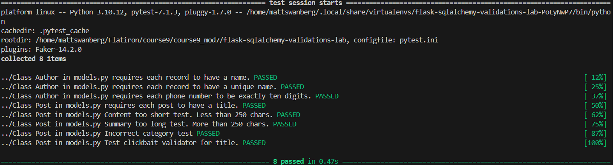

# Flask-SQLAlchemy Validations Lab

## Project Overview

This project demonstrates how to implement model-level data validation in a Flask application using SQLAlchemy.

The application simulates the backend of a blog publishing platform, where authors and posts must meet specific requirements before their information can be stored in the database.

Using SQLAlchemy's `@validates()` decorator, the application enforces rules for required fields, unique author names, phone number formatting, content length, categories, and title keywords.

The goal is to improve data integrity, prevent invalid records, and demonstrate how validation logic can be implemented directly within database models.

## Technologies Used

- **Python** — Application logic and validation
- **Flask** — Web application framework
- **Flask-SQLAlchemy** — Database models and ORM integration
- **SQLAlchemy** — Attribute-level validation and database queries
- **SQLite** — Relational database
- **Flask-Migrate / Alembic** — Database migrations
- **Pytest** — Automated testing
- **Faker** — Generating sample test data
- **Pipenv** — Dependency and virtual environment management

## Project Features

### Author Model

The `Author` model stores information about blog authors and validates their attributes before assignment.

**Name Validation**
- Author names must be strings.
- Names cannot be empty or contain only whitespace.
- Each author must have a unique name.
- Duplicate-name checks exclude the current author's ID when querying existing records.
- Database-level uniqueness constraints provide additional protection.

**Phone Number Validation**
- Phone numbers must be strings.
- Phone numbers must contain exactly 10 digits.
- Letters, symbols, spaces, and other non-digit characters are rejected.
- Phone numbers are stored as strings to preserve leading zeros.

### Post Model

The `Post` model represents blog posts and enforces several content and formatting requirements.

**Title Validation**
- Titles must be nonempty strings.
- Whitespace-only titles are rejected.
- Each title must contain at least one of the following phrases:
  - `Won't Believe`
  - `Secret`
  - `Top`
  - `Guess`
- Keyword matching is case-sensitive.

**Content Validation**
- Content must be a string.
- Content must contain at least 250 characters.
- Content containing fewer than 250 characters raises a `ValueError`.

**Summary Validation**
- Summaries are optional.
- Provided summaries must be strings.
- Summaries cannot exceed 250 characters.
- A summary containing exactly 250 characters is accepted.

**Category Validation**
- Categories must be provided when assigned.
- Only the following categories are accepted:
  - `Fiction`
  - `Non-Fiction`
- Any other category raises a `ValueError`.

## How Validation Works

The application uses SQLAlchemy's `@validates()` decorator to check attribute values before they are assigned to model instances.

Each validator follows a similar process:

1. Receives the proposed attribute value.
2. Checks the value against the applicable business rules.
3. Raises a `ValueError` if validation fails.
4. Returns the validated value if all conditions are satisfied.

For example, the following validator ensures that blog content contains at least 250 characters:

```python
@validates('content')
def validates_content(self, key, content):
    if not isinstance(content, str):
        raise ValueError("Content must be a string")

    if len(content) < 250:
        raise ValueError("Content is too short.")

    return content
```

These validators run when their corresponding mapped attributes are assigned. Database constraints provide additional protection for fields such as author names.

## Installation and Setup

### 1. Clone the Repository

```bash
git clone https://github.com/Matt20Swanberg/flask-sqlalchemy-validations-lab
cd flask-sqlalchemy-validations-lab
```

Alternatively, clone your own GitHub repository if working from a personal fork.

### 2. Install Dependencies

Install the required dependencies using Pipenv:

```bash
pipenv install
```

Activate the virtual environment:

```bash
pipenv shell
```

### 3. Initialize the Database

Navigate into the server directory:

```bash
cd server
```

Apply the existing database migrations:

```bash
flask db upgrade
```

### 4. Seed the Database

Populate the database with the provided sample data:

```bash
python seed.py
```

The project uses existing database migrations. Additional migrations are not required when only changing Python validation methods.

## Running the Tests

This project follows a test-driven development approach.

Automated tests verify that the models accept valid data and reject values that violate the validation requirements.

From the `server/` directory, run:

```bash
pytest -v
```

To stop testing after the first failure:

```bash
pytest -x
```

### Test Coverage

| Test | Description | Result |
|------|-------------|--------|
| `test_requires_name` | Rejects authors with missing names | Passed |
| `test_requires_unique_name` | Rejects duplicate author names | Passed |
| `test_requires_ten_digit_phone_number` | Enforces phone number formatting | Passed |
| `test_requires_title` | Rejects posts with empty titles | Passed |
| `test_content_length` | Enforces the 250-character content minimum | Passed |
| `test_summary_length` | Enforces the 250-character summary maximum | Passed |
| `test_category` | Rejects unsupported post categories | Passed |
| `test_clickbait` | Requires an approved keyword in post titles | Passed |

**Final Test Results: 8 Passed, 0 Failed**

## Screenshots

The following screenshots demonstrate successful automated testing and model validation.

### Automated Test Results




## Key Concepts Demonstrated

### Model-Level Validation

Implemented SQLAlchemy validators directly within the `Author` and `Post` models to enforce data integrity before attribute values are assigned.

### Database Constraints

Used database constraints such as `unique=True` and `nullable=False` to provide additional protection against invalid records.

### SQLAlchemy Queries

Used database queries with `.filter()` and `.first()` to identify duplicate author names while excluding the current record.

### Python String Validation

Used built-in Python functions and methods, including:

- `len()` for character-length validation.
- `.isdigit()` for phone number formatting.
- `.strip()` for detecting whitespace-only values.
- `isinstance()` for checking attribute types.
- `in` and `not in` for membership validation.
- `any()` for checking whether titles contain approved keywords.

### Exception Handling

Used `ValueError` to reject invalid attribute assignments and provide descriptive feedback.

### Test-Driven Development

Used Pytest to identify failing validation requirements, implement corrections, and verify successful behavior.

### Code Maintainability

Organized validation methods by model attribute and added documentation to improve readability and maintainability.

## Potential Future Improvements

While the current implementation satisfies the assignment requirements, several enhancements could improve the application further:

- Add case-insensitive duplicate-name validation.
- Normalize whitespace in author names.
- Support international phone number formats.
- Implement case-insensitive title keyword matching.
- Add additional tests for unexpected data types and boundary conditions.
- Add database-level constraints for fields that must always be present.
- Improve handling of simultaneous requests that attempt to create duplicate authors.

## Conclusion

This project demonstrates how SQLAlchemy model validators can enforce business rules and improve data quality in a Flask application.

By combining Python validation methods, SQLAlchemy queries, database constraints, and automated testing, the application provides a more reliable foundation for managing blog authors and posts.

All eight provided tests passed, confirming that the implemented validations satisfy the tested assignment requirements.


## Author

Created by Matthew Swanberg as part of Course 9 Module 7 (Lab: Validations)